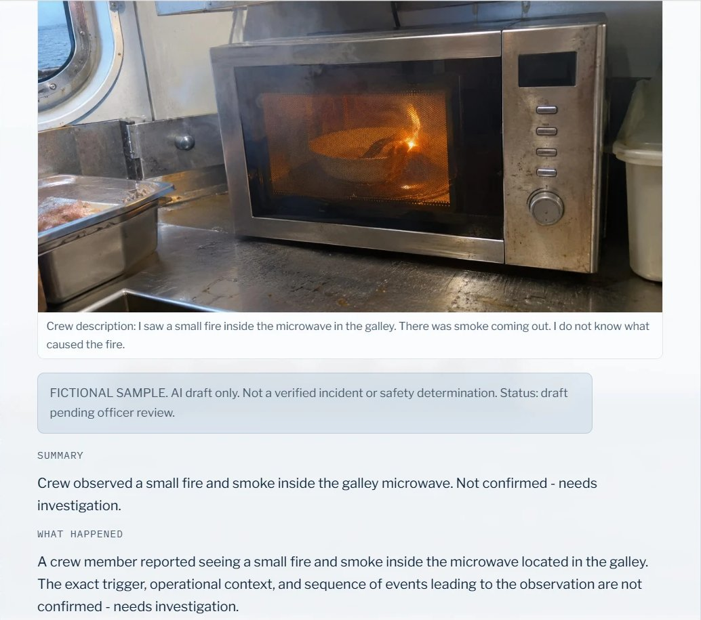
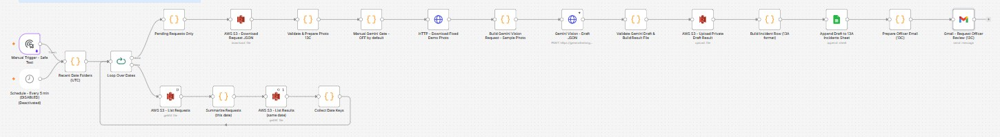
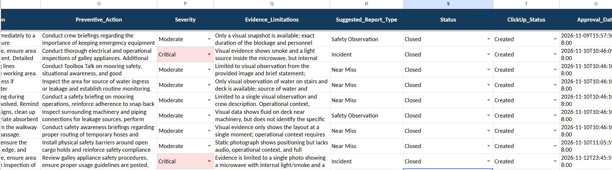
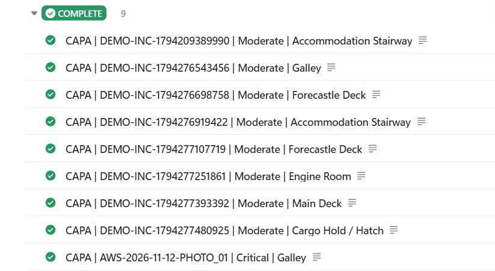

# 13C — Maritime Incident Intake on AWS (website → Lambda → S3 → n8n → Gemini Vision)

A public demo page lets a visitor pick one of **8 fictional shipboard safety photos**. AWS Lambda queues the request in a private S3 bucket, a self-hosted n8n workflow asks **Gemini Vision** for a structured incident draft, and the page shows the result. The same draft becomes a row in the **13A incident sheet** with an officer review email, so the existing 13A approval (ClickUp CAPA) and 13B closing workflows handle it without changes.

> **All data is fictional.** Bucket names, the CloudFront domain, the Function URL, the Google Sheet ID, the officer email and credential IDs are replaced with `YOUR_...` placeholders.

## Flow

```
13c-demo.html (CloudFront)
  │ POST {photo_id}            GET ?request_id=…
  ▼                                  ▲
Lambda Function URL ──► S3 requests/<date>/PHOTO_0X.json
                                     │
n8n (every 5 min, self-hosted)       │
  Recent date folders (3 days) → Loop: list requests + results per date
  → Pending only (no result yet) → validate request → Gemini gate (max 3/run)
  → download fixed photo → Gemini Vision (3 retries) → validate draft
  → S3 results/<date>/PHOTO_0X.json ──► page shows the draft
  → 13A sheet row "Pending Officer Approval" → officer email
                                     │
13A (existing): Approved → ClickUp CAPA → 13B (existing): ClickUp done → Closed
```

## Files

| File | What it is |
|---|---|
| `13C_S3_Gemini_Incident_Intake.json` | n8n workflow (23 nodes). Import, connect credentials, replace `YOUR_...` values. |
| `lambda_function.py` | Lambda behind a Function URL: `POST` creates a request, `GET ?request_id=` returns `ready` / `pending` / `not_found`. |
| `13c-demo.html` | The demo page (plain HTML + JS, no libraries). Set `API` to your Function URL. |
| `screenshots/` | Evidence from the end-to-end test. |

## End-to-end test (passed)

| AI draft on the demo page | n8n workflow |
|---|---|
|  |  |

| Website case closed in the 13A sheet | ClickUp CAPA complete |
|---|---|
|  |  |

Website request → Gemini draft → page result → sheet row + officer email → officer **Approved** → 13A ClickUp CAPA → task **Complete** → 13B **Closed**.

## Safety and cost controls

| Control | How |
|---|---|
| No visitor uploads | Only `PHOTO_01`–`PHOTO_08`; photo and crew description are fixed |
| Daily AI cap | S3 `IfNoneMatch` allows one request per photo per UTC day → **max 8 Gemini calls/day**. A repeat request gets `409` with the same `request_id`, so the visitor still sees the shared draft |
| No duplicate AI calls | A request with `results/<date>/PHOTO_0X.json` (or `.failed.json`) is never sent again |
| Retry-safe | Gemini `503`/`429`: 3 tries inside the run, then retried on the next schedule (no file written). A reply that fails validation writes `.failed.json`, so it is not paid for twice |
| Backlog aware | Pending = request without a result in S3, so requests made while n8n is offline are processed when it is back (3-day window) |
| Private data | S3 bucket is private; Lambda returns whitelisted result fields only; `request_id` is strictly validated |
| Browser limits | Function URL CORS and an origin check allow only the portfolio domain (scripts can still call it; the caps above are the real limit) |
| Spend alarm | AWS Budget ($5) with email; account concurrency cap of 10 |
| Kill switches | `ENABLE_PUBLIC_API = False` in Lambda, unpublish the n8n workflow, set the Gemini gate to `false`, or delete the Function URL |

Measured cost during build and test: about **$0.11** for the month. Expected live cost: under $1/month (Lambda and CloudFront within free tier; S3 listing about $0.25/month if n8n polls 24 h).

## n8n S3 node notes (why the loop exists)

Found while testing with `n8n-nodes-base` S3 V2:

1. **Get Many** sends `delimiter=/`, so a prefix like `requests/` does not list files in date sub-folders.
2. It reads `options` (folder key) from **item 0 only**, so several input items all list the first item's folder.

The workflow therefore lists **one date per loop pass** (`Loop Over Dates`, batch size 1), and the S3 node reads its folder from its own input (`$json.results_prefix`).

## Setup

**AWS**
1. Private S3 bucket with `maritime-incident-demo/requests/` and `results/`.
2. Lambda (Python) with `lambda_function.py`; set `BUCKET`, `ALLOWED_ORIGIN`. Execution role: `s3:PutObject` on `requests/*` and this read-only policy:
   ```json
   {"Version":"2012-10-17","Statement":[{"Effect":"Allow","Action":"s3:GetObject",
     "Resource":["arn:aws:s3:::YOUR_S3_BUCKET/maritime-incident-demo/results/*",
                 "arn:aws:s3:::YOUR_S3_BUCKET/maritime-incident-demo/requests/*"]}]}
   ```
3. Function URL, auth `NONE`, CORS origin = your site, methods `GET, POST`, header `content-type`. Add both permissions: `lambda:InvokeFunctionUrl` (`--function-url-auth-type NONE`) and `lambda:InvokeFunction` with `--invoked-via-function-url`.
4. Upload `13c-demo.html` (set `API`) and the 8 photos under `maritime-incident-demo/photos/` to the site served by CloudFront.

**n8n**
1. Import the workflow; connect AWS (needs `ListBucket` on the demo prefix, `GetObject` on `requests/*`, `PutObject` on `results/*`; no `DeleteObject`), Gemini, Google Sheets and Gmail credentials.
2. Replace `YOUR_S3_BUCKET`, `YOUR_CLOUDFRONT_DOMAIN`, `YOUR_GOOGLE_SHEET_ID`, `YOUR_OFFICER_EMAIL`.
3. Test with the Manual Trigger first; the exported file has the Gemini gate **on** and the schedule **enabled**, so set the gate to `false` if you only want a dry run.
4. Publish when you want the live demo to process requests.

Requires the 13A sheet columns (`Report_ID`, `Status`, `ClickUp_Status`, `ClickUp_Task_ID`, …) and the 13A/13B workflows for approval and closing.
