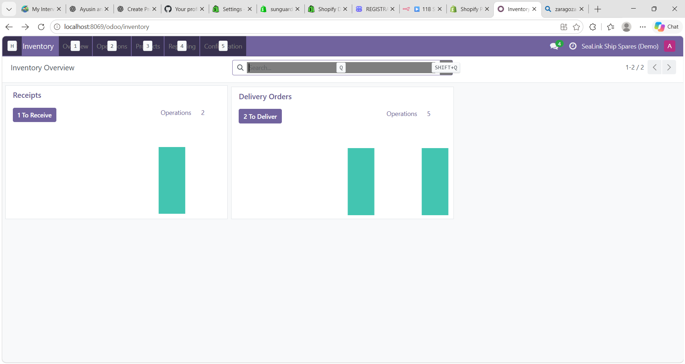
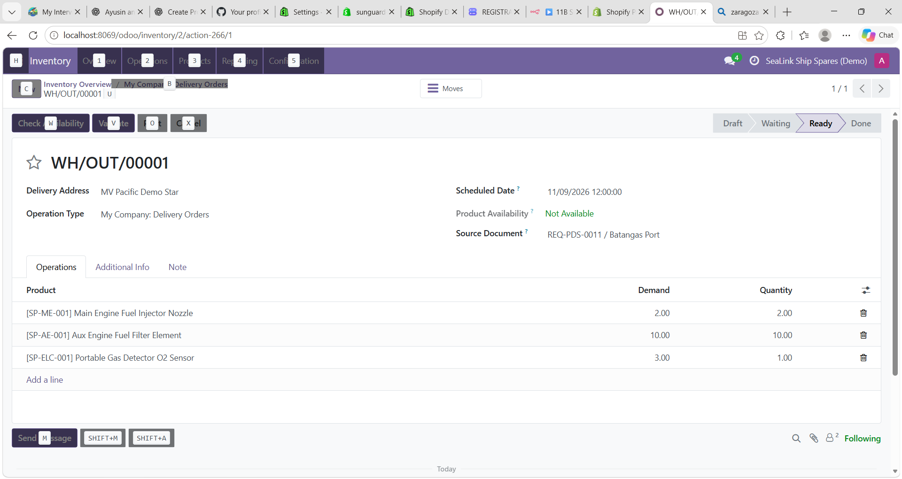
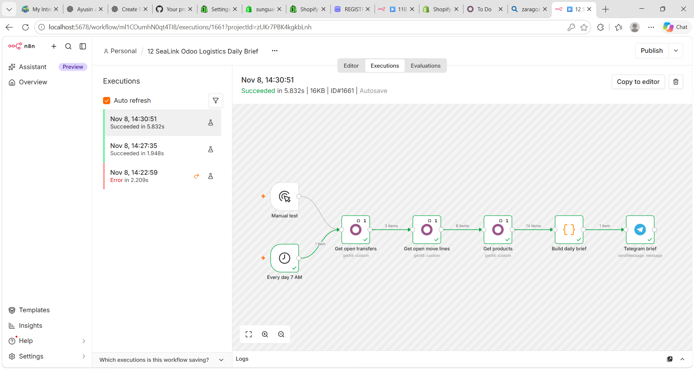
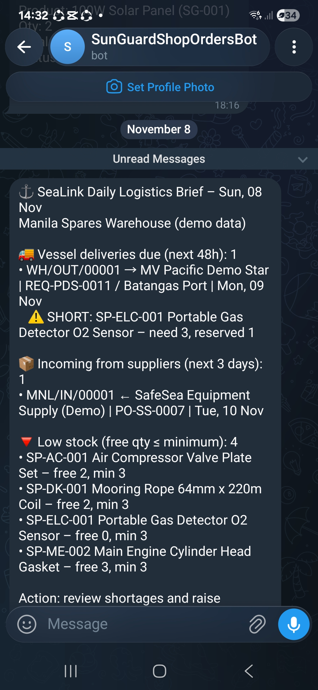

# 12 — SeaLink Odoo logistics brief

**Flow:** `Manual test / Every day 7 AM` → Get open transfers (`stock.picking`) → Get open move lines (`stock.move`) → Get products (`SP-`) → **Build daily brief** (Code) → Telegram.

The brief lists:
- **Shortages** — reserved quantity below demand on open deliveries
- **Deliveries due** in the next 2 days and **receipts** in the next 3 days
- **Low stock** against per-item minimums (default 3; e.g. safety/navigation items higher)

Open transfers = state is not `done` and not `cancel`. Timezone offset +8 (Manila).

| Odoo overview | Short delivery |
|---|---|
|  |  |

| n8n canvas | Telegram brief |
|---|---|
|  |  |

**Setup:** Odoo API credential (Site URL `http://host.docker.internal:8069`, your DB, user, API key) and Telegram credential with `YOUR_TELEGRAM_CHAT_ID`. Runs on schedule only when the workflow is published and Odoo/Docker are up.
