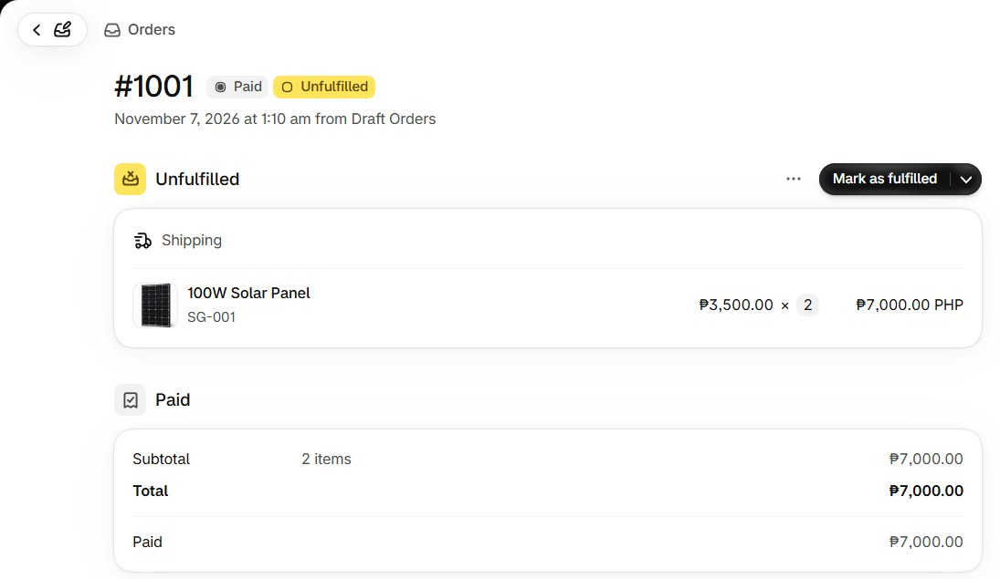
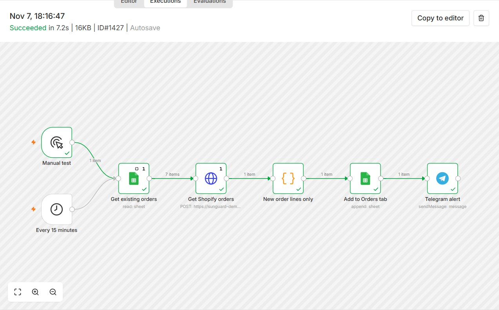
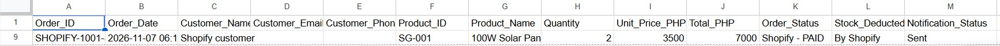
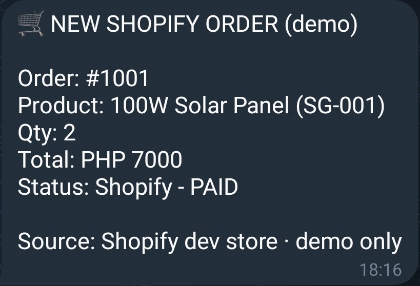

# 11B — Shopify orders → Google Sheet → Telegram

**Flow:** `Manual test / Every 15 minutes` → Get existing orders (Sheet) → Get Shopify orders (GraphQL) → *New order lines only* (Code) → Add to Orders tab → Telegram alert.

Only orders not already in the sheet are added, so it is safe to run repeatedly.

| 1. Shopify order | 2. n8n execution |
|---|---|
|  |  |

| 3. Sheet row | 4. Telegram alert |
|---|---|
|  |  |

**Setup:** Shopify OAuth2 credential (Admin API `read_orders`), Google Sheets and Telegram credentials; replace `YOUR-STORE`, `YOUR_GOOGLE_SHEET_ID`, `YOUR_TELEGRAM_CHAT_ID`.
