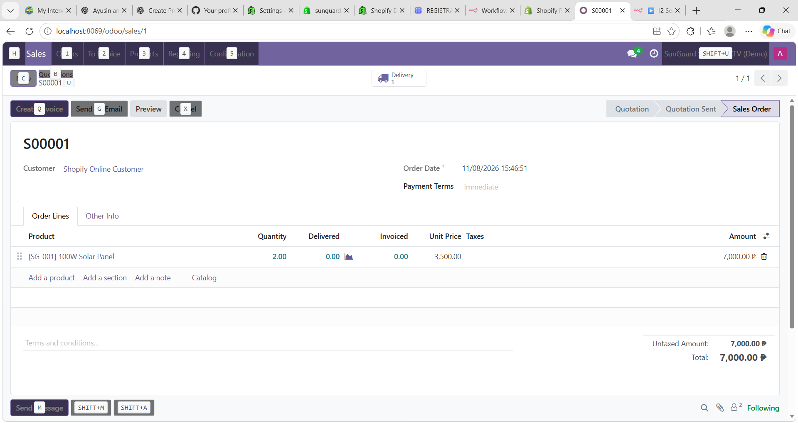
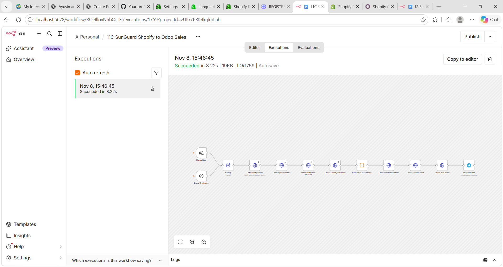
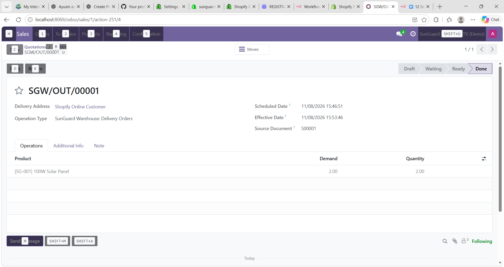
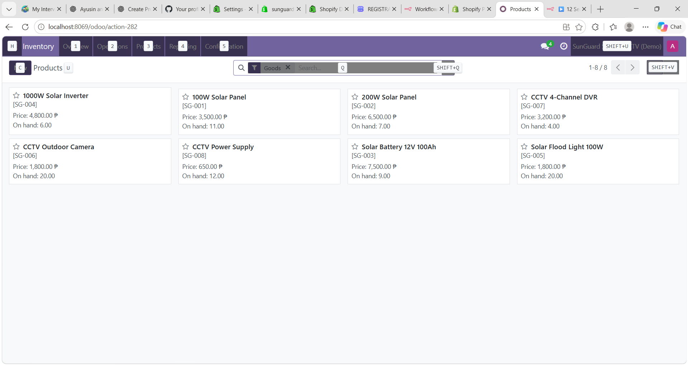
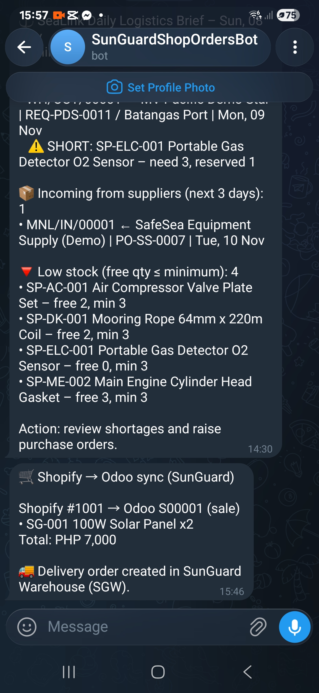

# 11C — Shopify → n8n → Odoo (sales order + stock)

**Flow:** `Every 15 minutes` → **Config** → Get Shopify orders (GraphQL) → Odoo: synced orders → Odoo: SunGuard products → Odoo: Shopify customer → *Build new Odoo orders* (Code) → Odoo: create sale order → Odoo: confirm order → Odoo: read order → Telegram alert.

- Calls Odoo through **JSON-RPC** (`execute_kw`) with `allowed_company_ids` so orders land in the **SunGuard** company (the built-in n8n Odoo node only uses the default company).
- Each order is stored with reference `SHOPIFY-<order number>`; already-synced orders are skipped (duplicate-safe).
- Confirming the order creates the delivery; validating it deducts stock in Odoo.

| 1. Odoo sales order | 2. n8n canvas |
|---|---|
|  |  |

| 3. Delivery validated | 4. Stock updated |
|---|---|
|  |  |

**Setup:** edit the **Config** node — `odoo_url`, `odoo_db`, `odoo_uid`, `odoo_api_key`, `sunguard_company_id`. Import `../data/sunguard_odoo_products.csv` and `sunguard_opening_stock.csv` into Odoo first.
